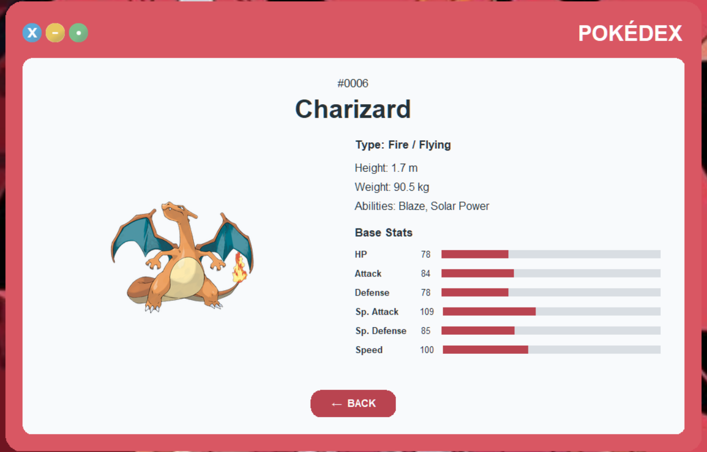

# Python Pokédex API

A desktop Pokédex application built with Python.

The main idea of this project was to practice working with REST APIs while also creating a graphical interface instead of only displaying the results in the console.

The application connects to [PokéAPI](https://pokeapi.co/) to retrieve Pokémon information and displays it using a custom Tkinter interface inspired by the classic Pokédex.

## Screenshots

### Pokémon Search


### Pokémon Information




## Features

- Search Pokémon by name or Pokédex ID
- Integration with PokéAPI
- Pokémon official artwork
- Pokémon type information
- Height and weight
- Abilities
- Base statistics:
  - HP
  - Attack
  - Defense
  - Special Attack
  - Special Defense
  - Speed
- Visual stat bars
- Custom error handling
- Responsive desktop layout
- Custom frameless Tkinter interface
- Custom window controls
- Rounded UI components
- Keyboard search using Enter
- Navigation between search and Pokémon information screens

## Technologies

- Python
- Tkinter
- Requests
- Pillow
- PokéAPI

## Project Structure

```text
python-pokedex-api/
│
├── assets/
│   ├── icons/
│   │   ├── cerrar.png
│   │   ├── minimizar.png
│   │   ├── restaurar.png
│   │   ├── pokeball.png
│   │   └── pokeball.ico
│   │
│   └── screenshots/
│       ├── search.png
│       └── pokemon-details.png
│
├── src/
│   ├── __init__.py
│   ├── api_client.py
│   ├── pokemon.py
│   └── utils.py
│
├── ui/
│   ├── __init__.py
│   ├── app.py
│   ├── pokemon_frame.py
│   ├── rounded_widgets.py
│   ├── search_frame.py
│   ├── styles.py
│   └── window_controls.py
│
├── main.py
├── requirements.txt
├── .gitignore
└── README.md
```

## How It Works

The application is separated into different modules to keep the API logic and user interface independent.

`api_client.py` is responsible for communicating with PokéAPI.

`pokemon.py` transforms the JSON response into a simpler structure that can be used by the application.

The `ui` folder contains the Tkinter interface, including the search screen, Pokémon information screen, custom window controls and rounded UI components.

The basic data flow is:

```text
User Search
    ↓
PokéAPI Request
    ↓
JSON Response
    ↓
Data Processing
    ↓
Tkinter Interface
```

## Installation

Clone the repository:

```bash
git clone https://github.com/aktechmx/python-pokedex-api.git
```

Enter the project directory:

```bash
cd python-pokedex-api
```

Create a virtual environment:

```bash
python -m venv .venv
```

Activate it on Windows:

```powershell
.\.venv\Scripts\Activate.ps1
```

Install the dependencies:

```bash
pip install -r requirements.txt
```

## Run the Application

Run:

```bash
python main.py
```

Then enter a Pokémon name such as:

```text
charizard
pikachu
gengar
```

or use its Pokédex ID:

```text
6
25
94
```

## Error Handling

The application includes custom exceptions to avoid showing HTTP or API errors directly to the user.

For example, if a Pokémon does not exist, the application displays a simple message instead of an HTTP 404 error.

This keeps the technical API errors separated from the messages shown in the graphical interface.

## What I Practiced

With this project I worked with:

- REST API consumption
- JSON data processing
- Nested dictionaries and lists
- Custom exceptions
- HTTP error handling
- Tkinter interfaces
- Multiple application views
- Image processing with Pillow
- Custom widgets
- Responsive desktop layouts
- Project modularization

## Future Improvements

Some ideas I would like to add in future versions:

- Better Windows taskbar and Alt + Tab integration for the frameless window
- Pokémon type colors
- Shiny Pokémon artwork
- Previous / Next Pokémon navigation
- Pokémon species descriptions
- Generation and habitat information
- Search history
- Automated tests

## API

Pokémon information is provided by:

[PokéAPI](https://pokeapi.co/)

## Disclaimer

This project was created for learning and portfolio purposes.

Pokémon and Pokémon character names are trademarks of Nintendo, Game Freak and The Pokémon Company.
